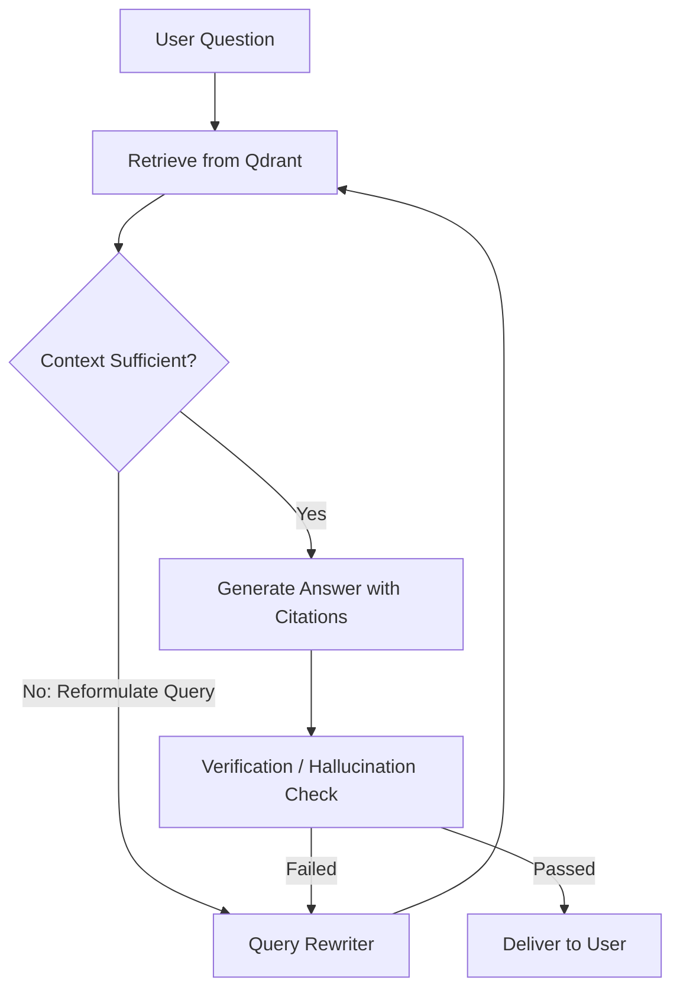

Retrieval-Augmented Generation (RAG) is often introduced as a simple five-step recipe: split documents, compute embeddings, store in a vector database, run cosine similarity search on the user's query, and stuff the top 3 chunks into the system prompt.

In production, naive RAG fails quickly. Users ask questions with temporal constraints (*"What changed in our reconciliation policy after Q2?"*), comparative requirements across accounts, or negative conditions (*"Which clients did not submit payment advice?"*). Cosine similarity knows nothing about dates, metadata filters, or logical negation.

Here is what it takes to build a production-grade RAG pipeline using Qdrant, LangChain, and LangGraph.

## 1. Chunking with Intent: Beyond Fixed Token Windows

Splitting text every 500 tokens with a 50-token overlap breaks semantic boundaries. A table containing debit and credit transactions gets sliced in half, leaving the header on chunk A and the dollar amounts on chunk B.

Instead, production chunking must be **structure-aware**:
- Markdown headers define natural semantic parents.
- Tabular data should be stored as serialized rows with schema context repeated per chunk.
- Metadata (client ID, document date, department, document version) must be attached to the vector payload at ingestion time.

```python
# Payload-driven vector indexing in Qdrant
from qdrant_client import QdrantClient
from qdrant_client.http import models

client = QdrantClient(host="localhost", port=6333)

client.upsert(
    collection_name="financial_policies",
    points=[
        models.PointStruct(
            id=point_id,
            vector=embedding_vector,
            payload={
                "client_id": "epigee-client-04",
                "doc_type": "reconciliation_guideline",
                "effective_date": "2025-07-01",
                "text": chunk_text,
                "section": "split_payment_exceptions",
            },
        )
    ],
)
```

## 2. Hybrid Retrieval with Payload Filtering

Vector embeddings excel at conceptual nuance: matching *"how do we handle partial invoice settlements?"* to a paragraph entitled *"Split payment guidelines"*.

However, when searching for an exact client code like `INV-2025-9981`, dense embeddings perform worse than exact keyword search (BM25) or deterministic SQL lookups.

The solution is **hybrid filtering in Qdrant**:
1. Apply hard metadata filters (e.g. `client_id == target_client`).
2. Run dense semantic vector search within that pre-filtered candidate subset.
3. Rerank top results with a cross-encoder before passing to the model.

## 3. Stateful Graph Cycles with LangGraph

The limitation of simple LangChain chains is that they are linear pipelines: `retrieve -> augment -> generate`. If the retrieved context is irrelevant or incomplete, the model is forced to hallucinate or apologize.

LangGraph introduces **cyclic execution loops**:



In LangGraph, each state transition evaluates real assertions:
- Did the LLM cite actual chunk IDs from the retrieval payload?
- Does the response contradict any numbers extracted in previous turns?
- If retrieval returned zero results, the graph loops to a query expansion node to broaden terms rather than hallucinating answers.

Stateful agentic graphs turn probabilistic language models into resilient, auditable engineering systems.
